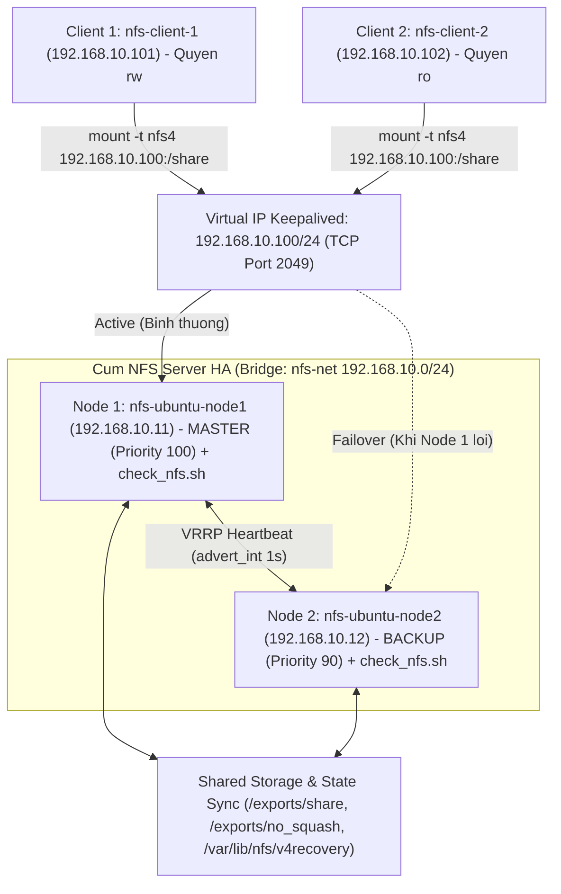
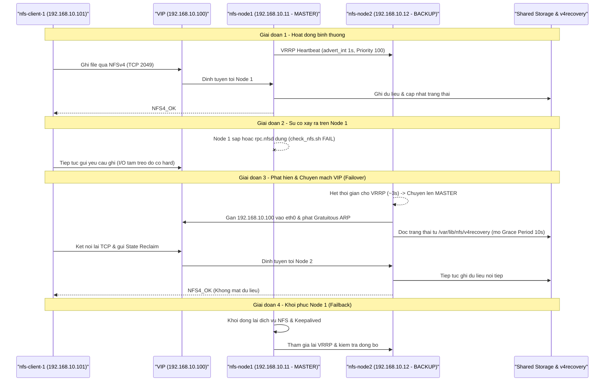

# Thiết kế Kiến trúc Cụm NFS Server High Availability (HA)

- **Đề tài:** Tìm hiểu và Triển khai Hệ thống Network File System (NFS) & High Availability
- **Tài liệu nền tảng lý thuyết:** [04-ha-theory.md](./04-ha-theory.md)
- **Thư mục mã nguồn liên quan:** `docker-nfs/`, `ha-cluster/`
- **Nhánh Git thực hiện:** `feat/nfs-ha-cluster`

---

## 1. Mục tiêu Thiết kế và Lựa chọn Giải pháp cho Cụm Lab

Dựa trên nền tảng lý thuyết đã phân tích tại [04-ha-theory.md](./04-ha-theory.md), kiến trúc cụm NFS HA của nhóm được thiết kế nhằm giải quyết triệt để điểm lỗi đơn (SPOF) trên `nfs-node1` bằng các lựa chọn kỹ thuật cụ thể sau:

1. **Mô hình cụm Active-Passive (2 Node):**
   - `nfs-node1` (`192.168.10.11`) đóng vai trò **MASTER**, `nfs-node2` (`192.168.10.12`) đóng vai trò **BACKUP**.
   - Tại một thời điểm chỉ một Node tiếp nhận kết nối ghi từ Client thông qua **Virtual IP (`192.168.10.100`)**, đảm bảo tương thích 100% với `nfs-kernel-server` (NFSv4) và ngăn ngừa xung đột khóa file / Split-Brain.
2. **Tầng Quản lý Cụm & VIP — Keepalived (VRRP):**
   - Sử dụng **Keepalived** (`virtual_router_id 51`, `advert_int 1s`) kết hợp script kiểm tra sức khỏe dịch vụ `ha-cluster/scripts/check_nfs.sh` và cơ chế **Gratuitous ARP (GARP)** để chuyển dịch VIP `192.168.10.100` gọn nhẹ ngay bên trong container Ubuntu 22.04.
3. **Tầng Lưu trữ & Giữ Trạng thái — Shared Storage + Đồng bộ Metadata NFSv4:**
   - Hai Node cùng ánh xạ vào vùng lưu trữ chia sẻ (`shared-data/public` và `shared-data/restricted`), cố định `fsid=0,1,2` trong `/etc/exports` để File Handle đồng nhất tuyệt đối.
   - Đồng bộ thư mục `/var/lib/nfs/v4recovery` và tinh chỉnh `nfsv4leasetime` / `nfsv4gracetime` xuống `10` giây qua script `ha-cluster/glusterfs-or-drbd/setup-shared-storage.sh`.

### Chỉ tiêu mục tiêu thiết kế

| Chỉ số | Mục tiêu thiết kế | Cơ chế bảo đảm |
| :--- | :--- | :--- |
| **RTO (Thời gian chuyển mạch)** | **< 5 giây** | Chu kỳ VRRP `advert_int 1s` (`~3s` phát hiện node chết) + `check_nfs.sh` kiểm tra mỗi `1s` (`fall 2`) + GARP làm mới ARP tức thời. |
| **RPO (Mất mát dữ liệu)** | **0 (Không mất dữ liệu)** | Ghi đồng bộ `sync` trên export + Shared Storage dùng chung trực tiếp giữa hai Node. |
| **Tính liên tục của Client** | Không phải `umount`/`mount` lại | Client mount qua VIP `192.168.10.100:/share` với cờ `vers=4,hard,timeo=50,retrans=2,proto=tcp`. |

---

## 2. Thiết kế Topology & Quy hoạch Địa chỉ IP

### 2.1. Sơ đồ Kiến trúc Tổng thể

Kiến trúc cụm HA kế thừa hoàn toàn subnet `192.168.10.0/24` (bridge `nfs-net`) từ `docker-nfs/docker-compose.yml` và bổ sung tầng Virtual IP `192.168.10.100/24`:



Sơ đồ chi tiết kết nối mạng, cổng giao thức và tầng lưu trữ dùng chung:

```text
+-----------------------------------+       +-----------------------------------+
|      nfs-client-1 (client-rw)     |       |      nfs-client-2 (client-ro)     |
|        IP: 192.168.10.101         |       |        IP: 192.168.10.102         |
|  Mount: 192.168.10.100:/share rw  |       |  Mount: 192.168.10.100:/share ro  |
+-----------------+-----------------+       +-----------------+-----------------+
                  |                                           |
                  +---------------------+---------------------+
                                        |  NFSv4 (TCP Port 2049)
                                        v
                        [ Virtual IP (VIP): 192.168.10.100 ]
                        [   Keepalived VRRP - VRID: 51     ]
                                        |
              +-------------------------+-------------------------+
              | (Active - MASTER)                                 | (Standby - BACKUP)
              | Priority: 100                                     | Priority: 90
              v                                                   v
+---------------------------+     VRRP Heartbeat (1s)     +---------------------------+
|     nfs-ubuntu-node1      | <=========================> |     nfs-ubuntu-node2      |
|    IP: 192.168.10.11      |     (Gratuitous ARP)        |    IP: 192.168.10.12      |
|  Keepalived + check_nfs   |                             |  Keepalived + check_nfs   |
|  NFSv4 (fsid=0,1,2)       |                             |  NFSv4 (fsid=0,1,2)       |
+-------------+-------------+                             +-------------+-------------+
              |                                                         |
              +------- Shared Storage / Đồng bộ dữ liệu & State --------+
              |  - Dữ liệu: /exports/share (public), /exports/no_squash |
              |  - Trạng thái NFSv4: /var/lib/nfs/v4recovery            |
              +---------------------------------------------------------+
```

### 2.2. Bảng Quy hoạch Địa chỉ IP, Vai trò và Cấu hình Export

| Thành phần | Tên Container / Hostname | Địa chỉ IP | Vai trò trong cụm HA | Cổng / Giao thức | Quyền Export / Ghi chú |
| :--- | :--- | :--- | :--- | :--- | :--- |
| **Mạng Docker** | `nfs-net` (bridge) | `192.168.10.0/24` | Mạng nội bộ kết nối Server & Client | Layer 2/3 Bridge | Toàn bộ container và VIP nằm cùng lớp mạng `/24`. |
| **Virtual IP (VIP)** | — | `192.168.10.100/24` | Địa chỉ dịch vụ duy nhất cho Client mount | `TCP 2049` (NFSv4) | Do Keepalived gán động lên `eth0` của Node đang giữ quyền `MASTER`. |
| **NFS Server Node 1** | `nfs-ubuntu-node1` (`nfs-node1`) | `192.168.10.11` | Keepalived **MASTER** (`priority 100`) | `TCP 2049`, `IP Proto 112` (VRRP) | Export `/exports` (`fsid=0`), `/exports/share` (`fsid=1`), `/exports/no_squash` (`fsid=2`). |
| **NFS Server Node 2** | `nfs-ubuntu-node2` (`nfs-node2`) | `192.168.10.12` | Keepalived **BACKUP** (`priority 90`) | `TCP 2049`, `IP Proto 112` (VRRP) | Cấu hình `/etc/exports` giống hệt Node 1; tiếp quản VIP khi Node 1 hoặc dịch vụ NFS lỗi. |
| **NFS Client 1** | `nfs-client-1` (`client-rw`) | `192.168.10.101` | Client kiểm thử đọc/ghi liên tục khi Failover | `TCP -> 192.168.10.100:2049` | Được cấp quyền `rw,sync,root_squash` trên `/share` và `rw,no_root_squash` trên `/no_squash`. |
| **NFS Client 2** | `nfs-client-2` (`client-ro`) | `192.168.10.102` | Client kiểm chứng phân quyền chỉ đọc trên VIP | `TCP -> 192.168.10.100:2049` | Chỉ có quyền `ro,sync,root_squash` trên `/share` (theo rule subnet `192.168.10.0/24`). |

---

## 3. Thiết kế Chi tiết Cấu hình Cụm HA

### 3.1. Thiết kế Thông số Keepalived (VRRP Instance `VI_NFS`)

Cả hai container Server (`nfs-node1` và `nfs-node2`) chạy tiến trình `keepalived` với cùng một cặp thông số VRRP đồng nhất, chỉ khác nhau ở vai trò khởi tạo (`state`), độ ưu tiên (`priority`) và địa chỉ ngang hàng (`unicast_peer`):

| Tham số Keepalived | Giá trị trên `nfs-node1` | Giá trị trên `nfs-node2` | Mục đích thiết kế |
| :--- | :--- | :--- | :--- |
| `vrrp_instance` | `VI_NFS` | `VI_NFS` | Tên nhóm VRRP quản lý dịch vụ NFS. |
| `interface` | `eth0` | `eth0` | Card mạng nội bộ kết nối vào `nfs-net`. |
| `virtual_router_id` | `51` | `51` | Định danh VRID thống nhất giữa 2 Node. |
| `state` | `MASTER` | `BACKUP` | `nfs-node1` mặc định giữ VIP khi cụm khởi động. |
| `priority` | `100` | `90` | Độ ưu tiên bầu chọn khi khởi động bình thường (`100 > 90`); khi `chk_nfs` lỗi, Node 1 chuyển trạng thái `FAULT` và phát gói VRRP `priority 0` để Node 2 thắng cử ngay lập tức. |
| `advert_int` | `1` | `1` | Chu kỳ gửi Heartbeat 1 giây/lần. |
| `unicast_src_ip` / `unicast_peer` | Src: `192.168.10.11` / Peer: `192.168.10.12` | Src: `192.168.10.12` / Peer: `192.168.10.11` | Dùng VRRP Unicast để truyền thông ổn định qua Docker bridge mà không phụ thuộc multicast. |
| `authentication` | `PASS` (shared secret) | `PASS` (shared secret) | Xác thực gói tin VRRP giữa hai Node hợp lệ. |
| `virtual_ipaddress` | `192.168.10.100/24` | `192.168.10.100/24` | Địa chỉ VIP di động gắn vào Node `MASTER`. |
| `track_script` | `chk_nfs` (`interval 1`, `timeout 1`, `fall 2`, `rise 2`) | `chk_nfs` (`interval 1`, `timeout 1`, `fall 2`, `rise 2`) | Theo dõi sức khỏe dịch vụ NFS mỗi 1 giây qua `check_nfs.sh`; lỗi 2 lần liên tiếp sẽ chuyển `VI_NFS` sang `FAULT` để nhường VIP ngay. |

### 3.2. Thiết kế Đồng bộ Lưu trữ, Export và Trạng thái NFSv4

Để Node 2 tiếp quản VIP mà không gặp lỗi `ESTALE (Stale file handle)` hay treo khóa 90 giây:

1. **Ánh xạ vùng lưu trữ dùng chung trong Docker:**
   - `../shared-data/public` $\rightarrow$ `/exports/share` (cả `nfs-node1` và `nfs-node2`)
   - `../shared-data/restricted` $\rightarrow$ `/exports/no_squash` (cả `nfs-node1` và `nfs-node2`)
2. **Đồng nhất `/etc/exports` với `fsid` cố định:**
   - `/exports` dùng `fsid=0,crossmnt,ro,sync,no_subtree_check`
   - `/exports/share` dùng `fsid=1,sync,no_subtree_check,root_squash` (`rw` cho `192.168.10.101`, `ro` cho `192.168.10.0/24`)
   - `/exports/no_squash` dùng `fsid=2,rw,sync,no_subtree_check,no_root_squash`
3. **Đồng bộ thư mục trạng thái `/var/lib/nfs/v4recovery`:**
   - Gắn vùng lưu trữ dùng chung cho `/var/lib/nfs/v4recovery` (hoặc đồng bộ định kỳ giữa 2 Node qua `setup-shared-storage.sh`) để bảo toàn danh sách `nfs4_clientid` khi failover.
4. **Tinh chỉnh tham số nhân NFSv4 trước khi chạy `rpc.nfsd`:**
   - Thiết lập `/proc/fs/nfsd/nfsv4leasetime = 10` và `/proc/fs/nfsd/nfsv4gracetime = 10` (thay vì mặc định `90` giây) giúp rút ngắn đáng kể thời gian chờ cấp khóa mới sau failover mà vẫn đủ biên độ an toàn cho Client gửi State Reclaim.

### 3.3. Thiết kế Tham số Mount phía Client tối ưu cho HA

Trên `nfs-client-1` (`192.168.10.101`) và `nfs-client-2` (`192.168.10.102`), điểm mount trỏ thẳng vào Virtual IP thay vì IP vật lý của Node 1:

```bash
mount -t nfs4 -o vers=4,hard,timeo=50,retrans=2,proto=tcp 192.168.10.100:/share /mnt/nfs/share
```

- **`192.168.10.100:/share`:** Đường dẫn NFSv4 pseudo-filesystem (`fsid=0` + `/share`) trỏ vào VIP.
- **`hard`:** Đảm bảo I/O trên Client tạm dừng an toàn trong vài giây chuyển mạch VIP, không bị lỗi `EIO` làm hỏng dữ liệu.
- **`timeo=50,retrans=2`:** Rút ngắn thời gian phát hiện kết nối gián đoạn (5.0 giây thay vì 60 giây mặc định), giúp Client kết nối lại tới Node 2 nhanh ngay sau khi Keepalived cập nhật GARP.

---

## 4. Kịch bản Chuyển đổi Dự phòng (Failover & Failback Workflow)

### 4.1. Biểu đồ Tuần tự (Sequence Diagram)



### 4.2. Chi tiết 4 giai đoạn vận hành

1. **Giai đoạn 1 — Hoạt động bình thường (Normal Operation):**
   - `nfs-node1` ở trạng thái `MASTER`, gắn VIP `192.168.10.100/24` trên `eth0` và phát VRRP Advertisement mỗi `1` giây sang `nfs-node2`.
   - `check_nfs.sh` trên cả hai Node định kỳ xác nhận tiến trình `nfsd`, cổng `TCP 2049` và `exportfs` đều khỏe mạnh.
   - `nfs-client-1` đọc/ghi dữ liệu liên tục vào `192.168.10.100:/share`; mọi dữ liệu đều đi qua `nfs-node1` xuống Shared Storage.
2. **Giai đoạn 2 — Kích hoạt sự cố (Failure Injection):**
   - Kịch bản thiết kế hỗ trợ kiểm thử cả 2 dạng lỗi thực tế:
     - **Hard Failure:** Dừng đột ngột container `nfs-ubuntu-node1` (`docker stop nfs-ubuntu-node1`) hoặc ngắt giao diện mạng.
     - **Service Failure:** Dừng dịch vụ NFS theo thứ tự `touch /run/nfs_fault_inject && rpc.nfsd 0 && exportfs -ua` (ngắt luồng `nfsd` và đóng cổng `2049` trước khi bỏ export để tránh lỗi `ESTALE`) trong khi container `nfs-node1` vẫn chạy.
   - Yêu cầu ghi từ Client tạm thời chờ phản hồi TCP nhờ tùy chọn `hard`.
3. **Giai đoạn 3 — Phát hiện lỗi & Chuyển mạch VIP (Failover / Takeover):**
   - Với **Service Failure:** `check_nfs.sh` trả về mã lỗi `1` sau 2 lần kiểm tra liên tiếp (`interval 1s`, `fall 2`), Keepalived trên `nfs-node1` chuyển `VI_NFS` sang `FAULT`, gỡ VIP và phát gói VRRP `priority 0` giúp `nfs-node2` tiếp quản `MASTER` trong **~2–3.5 giây**.
   - Với **Hard Failure:** Sau ~3 giây không nhận được VRRP Advertisement từ Node 1, `nfs-node2` tự nâng lên `MASTER`.
   - `nfs-node2` gắn VIP `192.168.10.100/24`, phát **Gratuitous ARP** làm mới bảng ARP của `nfs-client-1` và `nfs-client-2`, tiếp nhận phiên TCP mới trên cổng `2049`, thực hiện State Reclaim trong Grace Period `10` giây và tiếp tục ghi dữ liệu.
4. **Giai đoạn 4 — Khôi phục Node 1 (Failback):**
   - Khi `nfs-node1` khởi động lại và `check_nfs.sh` đạt ngưỡng `rise 2` (`PASS` liên tiếp 2 lần):
     - **Chế độ Preempt (mặc định):** `nfs-node1` lấy lại quyền `MASTER` và VIP `192.168.10.100` do có `priority 100 > 90`.
     - **Chế độ Non-preempt (`nopreempt`):** Có thể bật nếu muốn giữ VIP ổn định trên `nfs-node2` để tránh phát sinh thêm một lần chuyển mạch khi bảo trì.

---

## 5. Thiết kế Bộ Script Triển khai (`ha-cluster/`) và Tiêu chí Nghiệm thu

### 5.1. Kiến trúc 3 Script trong `ha-cluster/`

| Đường dẫn tệp | Chức năng thiết kế | Hành vi & đầu ra mong đợi |
| :--- | :--- | :--- |
| `ha-cluster/scripts/check_nfs.sh` | Healthcheck cho Keepalived (`vrrp_script chk_nfs`) | Kiểm tra 5 điều kiện: (1) không tồn tại cờ lỗi `/run/nfs_fault_inject`, (2) luồng nhân `/proc/fs/nfsd/threads > 0`, (3) tiến trình `rpc.mountd` đang chạy, (4) cổng `TCP 2049` đang `LISTEN`, (5) `exportfs -s` có `/exports/share`. Trả mã `0` nếu đạt đủ, trả mã `1` nếu bất kỳ kiểm tra nào thất bại. |
| `ha-cluster/glusterfs-or-drbd/setup-shared-storage.sh` | Chuẩn bị Shared Storage & tối ưu State Recovery | Đảm bảo thư mục chia sẻ (`/exports/share`, `/exports/no_squash`) và thư mục trạng thái `/var/lib/nfs/v4recovery` sẵn sàng, đối chiếu `fsid=0,1,2` đồng nhất giữa `nfs-node1` và `nfs-node2`, và cấu hình `nfsv4leasetime` / `nfsv4gracetime` về `10` giây. |
| `ha-cluster/scripts/failover-test.sh` | Tự động kiểm thử Failover & đo lường RTO/RPO | Thực hiện luồng end-to-end: xác nhận VIP đang nằm trên `nfs-node1`, mount `192.168.10.100:/share` trên cả `nfs-client-1` (`rw`) và `nfs-client-2` (`ro`), chạy vòng lặp ghi file liên tục kèm tính mã **SHA-256**, đánh sập `nfs-node1`, bấm giờ đo **RTO** đến khi VIP chuyển sang `nfs-node2` và I/O ghi tiếp thành công, đối chiếu toàn vẹn checksum, kiểm chứng quyền `ro` trên `nfs-client-2`, và tự động failback về `nfs-node1`. |

### 5.2. Bảng Tiêu chí Nghiệm thu Cụm NFS HA

Hệ thống được xác nhận hoàn thành thiết kế và đạt yêu cầu nghiệm thu khi vượt qua đầy đủ 4 bài kiểm tra sau:

1. **Kiểm chứng chuyển mạch VIP tự động:** Sau khi đánh sập `nfs-node1` (tắt container hoặc dừng dịch vụ NFS), IP `192.168.10.100` tự động xuất hiện trên card mạng `eth0` của `nfs-node2` với **RTO < 5 giây**.
2. **Kiểm chứng tính minh bạch phía Client:** `nfs-client-1` chỉ mount duy nhất `192.168.10.100:/share`, không phải thực hiện `umount` hay thay đổi cấu hình IP khi Node 1 gặp sự cố.
3. **Kiểm chứng toàn vẹn dữ liệu (`RPO = 0`):** Tệp tin và chuỗi bản ghi được tạo trước, trong và sau thời điểm chuyển mạch có mã băm **SHA-256 khớp 100%**, không phát sinh lỗi `Stale file handle (ESTALE)` hay thiếu dòng dữ liệu.
4. **Kiểm chứng duy trì phân quyền Export:** Sau khi `nfs-node2` trở thành `MASTER`, `nfs-client-1` (`192.168.10.101`) vẫn ghi/đọc bình thường (`rw`), trong khi `nfs-client-2` (`192.168.10.102`) vẫn bị giới hạn chỉ đọc (`ro`) đúng như quy hoạch trong `/etc/exports`.

### 5.3. Hướng dẫn Vận hành & Demo Trực tiếp

Từ thư mục gốc của repository:

1. **Khởi chạy cụm 4 container NFSv4 + Keepalived HA:**
   ```bash
   docker compose -f docker-nfs/docker-compose.yml up -d --build
   ```
2. **Kiểm chuẩn Shared Storage, `fsid=0,1,2` và tham số trạng thái NFSv4:**
   ```bash
   ./ha-cluster/glusterfs-or-drbd/setup-shared-storage.sh
   ```
3. **Chạy kịch bản kiểm thử Failover & Failback tự động (CLI):**
   ```bash
   ./ha-cluster/scripts/failover-test.sh --mode both
   ```
   *(Có thể truyền `--mode service` để giả lập chết dịch vụ `nfsd`, hoặc `--mode hard` để giả lập tắt đột ngột container `nfs-ubuntu-node1`.)*
4. **Khởi động Web Dashboard giám sát & điều khiển trực quan (tại `http://localhost:8080`):**
   ```bash
   python3 ha-cluster/dashboard/server.py --port 8080
   ```
