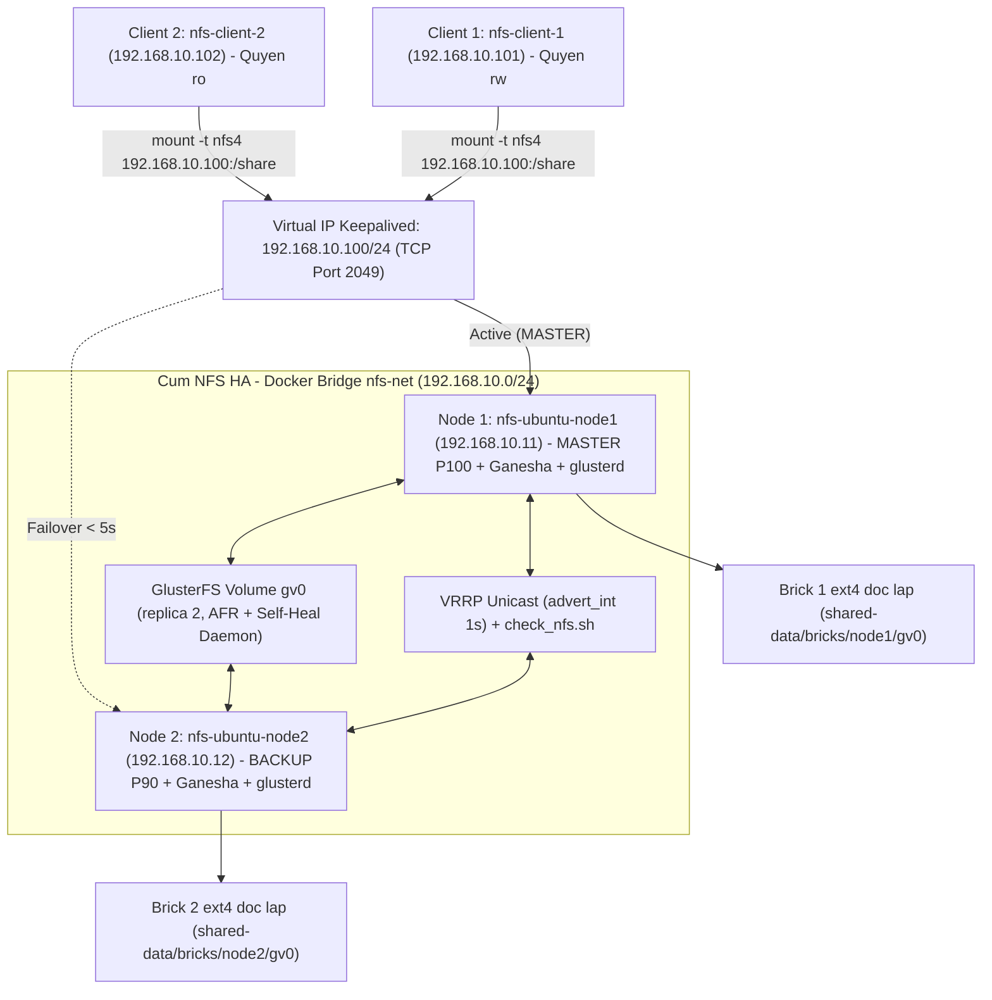
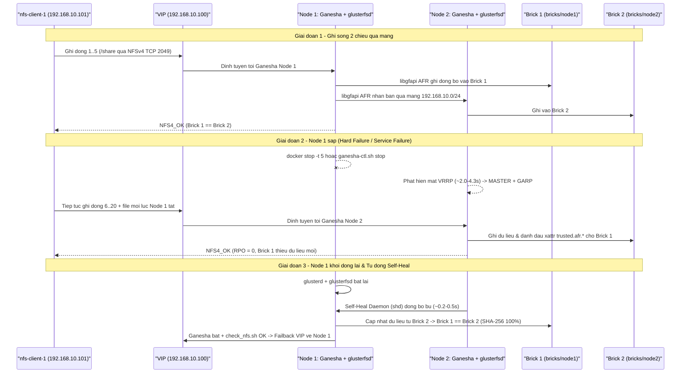

# Thiết kế Kiến trúc Cụm NFS Server High Availability (HA)

- **Môn học / Lớp:** `NT132.R12.ANTT` — Quản trị mạng
- **Đề tài:** Tìm hiểu và Triển khai Hệ thống Network File System (NFS) & High Availability
- **Tài liệu nền tảng lý thuyết:** [04-ha-theory.md](./04-ha-theory.md)
- **Thư mục mã nguồn liên quan:** `ha-cluster/` (độc lập với stack cơ sở `docker-nfs/`)
- **Nhánh Git thực hiện:** `feat/nfs-ha-cluster`

---

## 1. Mục tiêu Thiết kế và Lựa chọn Giải pháp cho Cụm Lab

Dựa trên nền tảng lý thuyết đã phân tích tại [04-ha-theory.md](./04-ha-theory.md), kiến trúc cụm NFS HA của nhóm được thiết kế nhằm loại bỏ hoàn toàn điểm lỗi đơn (SPOF) trên `nfs-node1` và thực thi **nhân bản dữ liệu hai chiều qua mạng** giữa hai máy chủ lưu trữ độc lập:

1. **Tầng Lưu trữ Phân tán — GlusterFS 10.1 (`replica 2`) trên 2 Brick cô lập:**
   - `nfs-ubuntu-node1` (`192.168.10.11`) ánh xạ độc lập thư mục ext4 host `shared-data/bricks/node1` vào `/data/brick`.
   - `nfs-ubuntu-node2` (`192.168.10.12`) ánh xạ độc lập thư mục ext4 host `shared-data/bricks/node2` vào `/data/brick` (tuyệt đối không mount chéo).
   - Volume phân tán `gv0` (`replica 2`) nhân bản đồng bộ mọi tệp trong `/share` và `/no_squash` qua mạng bridge `192.168.10.0/24`, hỗ trợ **Automatic Self-Heal Daemon (`shd`)** tự động đồng bộ bù dữ liệu khi một Node khởi động lại sau sự cố.
2. **Tầng Phục vụ NFSv4 — User-Space NFS-Ganesha 3.5 (`FSAL_GLUSTER` qua `libgfapi`):**
   - Cả hai Node chạy sẵn `ganesha.nfsd` ở chế độ Hot-Standby kết nối trực tiếp vào volume `gv0` bằng `libgfapi` (`FSAL { Name = GLUSTER; }`), bỏ qua hoàn toàn tầng FUSE trung gian và kernel `nfsd`.
   - NFS File Handle được sinh từ **GlusterFS GFID (UUID)** đồng nhất tuyệt đối giữa hai Node dù inode ext4 trên Brick 1 và Brick 2 hoàn toàn khác nhau, loại bỏ lỗi `Stale file handle (ESTALE)` khi chuyển mạch.
   - Bảo toàn trọn vẹn cấu hình phân quyền của nhóm: `/share` (`Export_Id = 1`, `RW` cho `192.168.10.101`, `RO` cho `192.168.10.0/24`, `Root_Squash` $\rightarrow$ `65534:65534`) và `/no_squash` (`Export_Id = 2`, `RW` cho `192.168.10.0/24`, `No_Root_Squash` $\rightarrow$ `0:0`).
3. **Tầng Quản lý Cụm & VIP — Keepalived (VRRP Unicast):**
   - Sử dụng **Keepalived** (`VI_NFS`, `VRID 51`, `advert_int 1s`) kết hợp script kiểm tra sức khỏe tốc độ cao `< 50 ms` ([check_nfs.sh](../ha-cluster/scripts/check_nfs.sh)) và **Gratuitous ARP (GARP)** để chuyển dịch Virtual IP `192.168.10.100/24` giữa `nfs-ubuntu-node1` và `nfs-ubuntu-node2`.

### Chỉ tiêu mục tiêu thiết kế

| Chỉ số | Mục tiêu thiết kế | Kết quả thực nghiệm đạt được | Cơ chế bảo đảm |
| :--- | :--- | :--- | :--- |
| **VIP Takeover RTO (Service Failure)** | **< 5 giây** | **~2.0–2.5 giây** | `/run/nfs_fault_inject` + `ganesha-ctl.sh stop` $\rightarrow$ `chk_nfs` (`interval 1s, fall 2`) đưa Node 1 về `FAULT` và phát VRRP priority `0`. |
| **VIP Takeover RTO (Hard Failure)** | **< 5 giây** | **~3.5–4.3 giây** | `docker stop -t 5` thu hồi VIP sạch sẽ hoặc VRRP `Master_Down_Interval` + GARP `garp_master_delay 1`. |
| **RPO (Mất mát dữ liệu)** | **0 (Không mất dữ liệu)** | **0 (`20/20` dòng, SHA-256 khớp 100%)** | GlusterFS AFR ghi đồng bộ + Client mount `hard,timeo=50,retrans=2`. |
| **Self-Heal sau sập nguồn** | **Tự động khớp 100%** | **~0.2–0.5 giây** (`0` entries) | GlusterFS `shd` tự đối chiếu xattr `trusted.afr.*` khi Node 1 quay lại và vá đầy đủ dữ liệu ghi lúc offline. |

---

## 2. Thiết kế Topology & Quy hoạch Địa chỉ IP

### 2.1. Sơ đồ Kiến trúc Tổng thể

Stack HA được đóng gói tự chủ tại [ha-cluster/docker-compose.yml](../ha-cluster/docker-compose.yml) trên mạng bridge `nfs-net` (`192.168.10.0/24`), tách biệt hoàn toàn với cấu hình cơ sở trong `docker-nfs/`:



Sơ đồ chi tiết các tầng dịch vụ và kho lưu trữ cô lập giữa hai Node:

```text
+-----------------------------------+       +-----------------------------------+
|      nfs-client-1 (client-rw)     |       |      nfs-client-2 (client-ro)     |
|        IP: 192.168.10.101         |       |        IP: 192.168.10.102         |
|  Mount: 192.168.10.100:/share rw  |       |  Mount: 192.168.10.100:/share ro  |
+-----------------+-----------------+       +-----------------+-----------------+
                  |                                           |
                  +---------------------+---------------------+
                                        |  NFSv4.0 (TCP Port 2049)
                                        v
                        [ Virtual IP (VIP): 192.168.10.100 ]
                        [   Keepalived VRRP - VRID: 51     ]
                                        |
              +-------------------------+-------------------------+
              | (Active - MASTER)                                 | (Standby - BACKUP)
              | Priority: 100                                     | Priority: 90
              v                                                   v
+---------------------------+     VRRP Heartbeat (1s)     +---------------------------+
|     nfs-ubuntu-node1      | <=========================> |     nfs-ubuntu-node2      |
|    IP: 192.168.10.11      |     (Gratuitous ARP)        |    IP: 192.168.10.12      |
|  Keepalived + check_nfs   |                             |  Keepalived + check_nfs   |
|  NFS-Ganesha FSAL_GLUSTER |     GlusterFS Replica 2     |  NFS-Ganesha FSAL_GLUSTER |
|  glusterd + glusterfsd    | <=========================> |  glusterd + glusterfsd    |
+-------------+-------------+    (AFR Sync + Self-Heal)   +-------------+-------------+
              |                                                         |
              v                                                         v
+---------------------------+                             +---------------------------+
| Brick 1 (ext4 doc lap)    |                             | Brick 2 (ext4 doc lap)    |
| shared-data/bricks/node1  |                             | shared-data/bricks/node2  |
|   -> /data/brick/gv0      |                             |   -> /data/brick/gv0      |
+---------------------------+                             +---------------------------+
```

### 2.2. Bảng Quy hoạch Địa chỉ IP, Vai trò và Brick Lưu trữ

| Thành phần | Tên Container / Hostname | Địa chỉ IP | Vai trò trong cụm HA | Lưu trữ & Cổng | Quyền Export / Ghi chú |
| :--- | :--- | :--- | :--- | :--- | :--- |
| **Mạng Docker** | `ha-cluster_nfs-net` (bridge) | `192.168.10.0/24` | Mạng nội bộ kết nối Client, VIP & GlusterFS | Layer 2/3 Bridge | Cô lập hoàn toàn hạ tầng HA trong `ha-cluster/`. |
| **Virtual IP (VIP)** | — | `192.168.10.100/24` | Điểm truy cập duy nhất cho toàn bộ NFS Client | `TCP 2049` | Gán động trên `eth0` của Node `MASTER`. |
| **HA Node 1** | `nfs-ubuntu-node1` (`nfs-node1`) | `192.168.10.11` | Keepalived **MASTER** (`priority 100`) | Brick `bricks/node1` + volume `glusterd-node1`; `TCP 2049`, `24007`, `49152+` | Export `/share` (`Export_Id = 1`), `/no_squash` (`Export_Id = 2`). |
| **HA Node 2** | `nfs-ubuntu-node2` (`nfs-node2`) | `192.168.10.12` | Keepalived **BACKUP** (`priority 90`) | Brick `bricks/node2` + volume `glusterd-node2`; `TCP 2049`, `24007`, `49152+` | Đồng cấu hình `ganesha.conf`, tiếp quản VIP & phục vụ khi Node 1 lỗi. |
| **NFS Client 1** | `nfs-client-1` (`client-rw`) | `192.168.10.101` | Client ghi liên tục khi Failover & thử `No_Root_Squash` | `TCP -> 192.168.10.100:2049` | `/share`: `RW`, `Root_Squash` (`65534:65534`); `/no_squash`: `RW`, `No_Root_Squash` (`0:0`). |
| **NFS Client 2** | `nfs-client-2` (`client-ro`) | `192.168.10.102` | Client kiểm chứng quyền chỉ đọc (`ro`) | `TCP -> 192.168.10.100:2049` | `/share`: chỉ đọc `RO`, `Root_Squash`. |

---

## 3. Thiết kế Chi tiết Cấu hình Cụm HA

### 3.1. Cấu hình Keepalived (VRRP Instance `VI_NFS`)

| Tham số Keepalived | Giá trị trên `nfs-node1` | Giá trị trên `nfs-node2` | Mục đích thiết kế |
| :--- | :--- | :--- | :--- |
| `vrrp_instance` / `VRID` | `VI_NFS` / `51` | `VI_NFS` / `51` | Nhóm VRRP chung trên card `eth0`. |
| `state` / `priority` | `MASTER` / `100` | `BACKUP` / `90` | Node 1 giữ VIP khi cụm ổn định; khi `chk_nfs` lỗi, Keepalived đưa `VI_NFS` vào `FAULT` và phát VRRP priority `0` để Node 2 thắng cử tức thì (không dùng `weight`). |
| `advert_int` | `1` giây | `1` giây | Chu kỳ Heartbeat VRRP Unicast (`unicast_src_ip` / `unicast_peer`). |
| `garp_master_*` | `delay 1`, `repeat 3`, `refresh 5` | `delay 1`, `repeat 3`, `refresh 5` | Quảng bá Gratuitous ARP cập nhật bảng MAC/ARP ngay khi chuyển VIP. |
| `authentication` | `PASS` (`nt132ha`) | `PASS` (`nt132ha`) | Khóa xác thực $\le 8$ ký tự theo giới hạn VRRP. |
| `track_script chk_nfs` | `interval 1`, `timeout 1`, `fall 2`, `rise 2` | `interval 1`, `timeout 1`, `fall 2`, `rise 2` | Chạy `/usr/local/sbin/check_nfs_runtime.sh` (bản copy `root:root 0755` từ `check_nfs.sh`). |

### 3.2. Cấu hình GlusterFS 10.1 (`gv0` Replica 2) & Non-Systemd Daemon

1. **`/etc/glusterfs/glusterd.vol`:** Tự động chèn `option rpc-auth-allow-insecure on` bên trong khối `volume management ... end-volume` (trước `end-volume`) trong [entrypoint.sh](../ha-cluster/gluster-ganesha/entrypoint.sh) để cho phép kết nối port cao (>1024) từ `libgfapi` và container Docker.
2. **Tham số Volume `gv0` (`replica 2`):**
   - `192.168.10.11:/data/brick/gv0` và `192.168.10.12:/data/brick/gv0`
   - `nfs.disable = on` (tắt NFSv3 cũ tích hợp trong Gluster để nhường cổng `2049` cho NFS-Ganesha)
   - `server.allow-insecure = on` (kích hoạt kết nối `libgfapi` nội bộ)
   - `cluster.quorum-type = none` (cho phép 1 Node sống sót tiếp tục ghi `rw` trong cụm 2-Node Lab)
   - `network.ping-timeout = 5` (giảm từ `42s` mặc định xuống `5s` để tránh treo I/O khi brick peer mất kết nối đột ngột)
   - `cluster.self-heal-daemon = on` (bật `glustershd` tự động đồng bộ bù sau sự cố)
3. **Tự động phục hồi sau Restart Container:** Khi `nfs-ubuntu-node1` khởi động lại từ `docker stop`, `entrypoint.sh` chờ `glusterfsd` lắng nghe cổng brick, kích hoạt nền `gluster volume heal gv0`, rồi mới khởi động `ganesha.nfsd` $\rightarrow$ bảo đảm Node 1 chỉ vượt qua `check_nfs.sh` (`rise 2`) và lấy lại VIP sau khi brick đã sẵn sàng.

### 3.3. Cấu hình NFS-Ganesha 3.5 (`FSAL_GLUSTER` — `ganesha.conf`)

File cấu hình [ha-cluster/gluster-ganesha/ganesha.conf](../ha-cluster/gluster-ganesha/ganesha.conf) được đồng nhất byte-for-byte trên cả hai Node:

- **`NFS_CORE_PARAM`:** `Protocols = 4;`, `mount_path_pseudo = true;`
- **`NFSV4`:**
  - `Graceless = true;` (bỏ qua 90 giây chờ Grace Period khi failover nóng bằng Keepalived để giữ `RTO < 5s`).
  - `Minor_Versions = 0;` & `Only_Numeric_Owners = true;` (**lưu ý tương thích nhân Linux 7.0:** trên Ubuntu 22.04 `nfs-ganesha 3.5`, Client nhân Linux 7.0 mặc định thử `NFSv4.2` gây `OP_GETATTR -> NFS4ERR_BADXDR` và trên `NFSv4.1` gửi `OP_GET_DIR_DELEGATION` khiến Ganesha trả `NFS4ERR_OP_ILLEGAL` ở lần `ls` đầu tiên sau Failover/Failback; cấu hình `Minor_Versions = 0` đưa `-o vers=4` đàm phán sạch về `NFSv4.0` với `0` lỗi suốt Failover/Failback, còn `Only_Numeric_Owners = true` đảm bảo trả chuẩn UID/GID số `65534:65534` thay vì ánh xạ chuỗi).
  - `Lease_Lifetime = 10;`, `Grace_Period = 10;`, `RecoveryBackend = "fs_ng";`
- **`EXPORT_DEFAULTS`:** `Anonymous_Uid = 65534;`, `Anonymous_Gid = 65534;`
- **`EXPORT` 1 (`/share`):** `Path = "/gv0/share"`, `Pseudo = "/share"`, `FSAL { Name = GLUSTER; Hostname = "127.0.0.1"; Volume = "gv0"; Volpath = "/share"; enable_upcall = true; }`; khối `CLIENT` ưu tiên `192.168.10.101` (`RW`, `Root_Squash`) đặt trước `192.168.10.0/24` (`RO`, `Root_Squash`).
- **`EXPORT` 2 (`/no_squash`):** `Path = "/gv0/no_squash"`, `Pseudo = "/no_squash"`, `FSAL { Name = GLUSTER; Hostname = "127.0.0.1"; Volume = "gv0"; Volpath = "/no_squash"; }`; `CLIENT { Clients = 192.168.10.0/24; Access_Type = RW; Squash = No_Root_Squash; }`.

### 3.4. Tham số Mount tối ưu phía Client

```bash
mount -t nfs4 -o vers=4,hard,timeo=50,retrans=2,proto=tcp 192.168.10.100:/share /mnt/nfs/share
```

*(Lưu ý: gói `netbase` đã được cài vào image nhằm cung cấp `/etc/protocols` cho cờ `proto=tcp` trên Client lẫn Server.)*

---

## 4. Kịch bản Failover, Chịu lỗi Offline & GlusterFS Self-Heal

### 4.1. Biểu đồ Tuần tự (Sequence Diagram)



### 4.2. Cơ chế Hai Chế độ Giả lập Sự cố

1. **Service Failure (`--mode service`):** Tạo cờ `/run/nfs_fault_inject` và gọi `/usr/local/sbin/ganesha-ctl.sh stop` (giữ thời gian chờ `SIGTERM` tối đa `1s` trước `SIGKILL` để đóng cổng `2049` nhanh gọn) trong khi container `nfs-ubuntu-node1`, `keepalived`, `glusterd` và `glusterfsd` tiếp tục chạy. Keepalived chuyển VIP sang Node 2 sau **~2.0–2.5s**; brick Node 1 vẫn nhận nhân bản trực tiếp qua `glusterfsd` từ Ganesha Node 2.
2. **Hard Failure + Self-Heal (`--mode hard`):** Chạy `docker stop -t 5 nfs-ubuntu-node1`. Keepalived Node 2 lấy VIP sau **~3.5–4.3s**; Client 1 ghi trọn vẹn `20/20` dòng (`RPO = 0`) và tạo thêm tệp `ha_selfheal_offline_proof.log` trong lúc Node 1 tắt. Kiểm tra ổ đĩa host xác nhận Brick 1 thiếu file mới và lệch SHA-256; khi bật lại `nfs-ubuntu-node1`, GlusterFS `shd` tự động đồng bộ về `0` pending entries trong **~0.2–0.5s** và SHA-256 giữa Brick 1 và Brick 2 khớp **100%**.

---

## 5. Bộ Script, Web Control Center & Hướng dẫn Vận hành

### 5.1. Danh sách Thành phần trong `ha-cluster/`

| Đường dẫn tệp | Chức năng thiết kế | Hành vi & đầu ra |
| :--- | :--- | :--- |
| `ha-cluster/docker-compose.yml` | Stack HA tự chủ 4 container | Gắn brick riêng (`node1:/data/brick`, `node2:/data/brick`), named volume `glusterd-node{1,2}`, chạy mạng `nfs-net` (`192.168.10.0/24`). |
| `ha-cluster/gluster-ganesha/` | Image & runtime GlusterFS + Ganesha + Keepalived | Gồm `Dockerfile`, `ganesha.conf`, `ganesha-ctl.sh` (`start/stop/status`) và `entrypoint.sh` (tự patch `glusterd.vol`, chạy D-Bus/rpcbind/glusterd/Keepalived, auto-heal & auto-start Ganesha khi restart). |
| `ha-cluster/scripts/check_nfs.sh` | Healthcheck `< 50 ms` cho Keepalived | Kiểm tra 5 điều kiện cục bộ (cờ `/run/nfs_fault_inject`, `ganesha.nfsd`, `glusterd`, `glusterfsd`, TCP `2049` `LISTEN`) — không gọi `gluster` CLI RPC. |
| `ha-cluster/glusterfs-or-drbd/setup-shared-storage.sh` | Bootstrap & kiểm chuẩn 6 bước idempotent | Kiểm tra cô lập brick, peer 2 Node, dọn xattr mồ côi khi tạo lại `gv0`, bật các tham số HA, tạo `/share` & `/no_squash` (`0777`), khởi chạy Ganesha và kiểm chứng SHA-256 Brick 1 == Brick 2. |
| `ha-cluster/scripts/failover-test.sh` | Kiểm thử Failover, sai lệch Brick & Self-Heal | Chạy kịch bản `--mode service|hard|both`, đo VIP Takeover RTO, chứng minh Brick 1 thiếu/lệch khi tắt và tự đồng bộ 100% SHA-256 khi Node 1 quay lại, kiểm chứng `ro` trên `nfs-client-2`. |
| `ha-cluster/dashboard/{server.py,index.html}` | Web Control Center (Python stdlib, port `8080`) | Hiển thị sơ đồ 2 Brick độc lập, trạng thái GlusterFS (`Online Bricks`, `Peer`, `Pending Self-Heal`), bảng đối chiếu SHA-256 từng tệp giữa Brick 1 vs Brick 2 theo thời gian thực, khóa đồng bộ `TASK_LOCK` (`HTTP 409`) và nút điều khiển Chaos/Self-Heal. |

### 5.2. Hướng dẫn Chạy Lab & Demo Trực tiếp

Từ thư mục gốc của repository:

1. **Dừng stack cơ sở `docker-nfs` (nếu đang chạy để tránh trùng subnet/tên container) và dựng cụm HA mới:**
   ```bash
   docker compose -f docker-nfs/docker-compose.yml down 2>/dev/null || true
   docker compose -f ha-cluster/docker-compose.yml up -d --build
   ```
2. **Khởi tạo GlusterFS `gv0` (`replica 2`), NFS-Ganesha & kiểm chứng đồng bộ sống:**
   ```bash
   ./ha-cluster/glusterfs-or-drbd/setup-shared-storage.sh
   ```
3. **Chạy bộ kiểm thử Failover, Offline Divergence & GlusterFS Self-Heal:**
   ```bash
   ./ha-cluster/scripts/failover-test.sh --mode both
   ```
4. **Mở Web Control Center trực quan tại `http://localhost:8080`:**
   ```bash
   python3 ha-cluster/dashboard/server.py --port 8080
   ```
